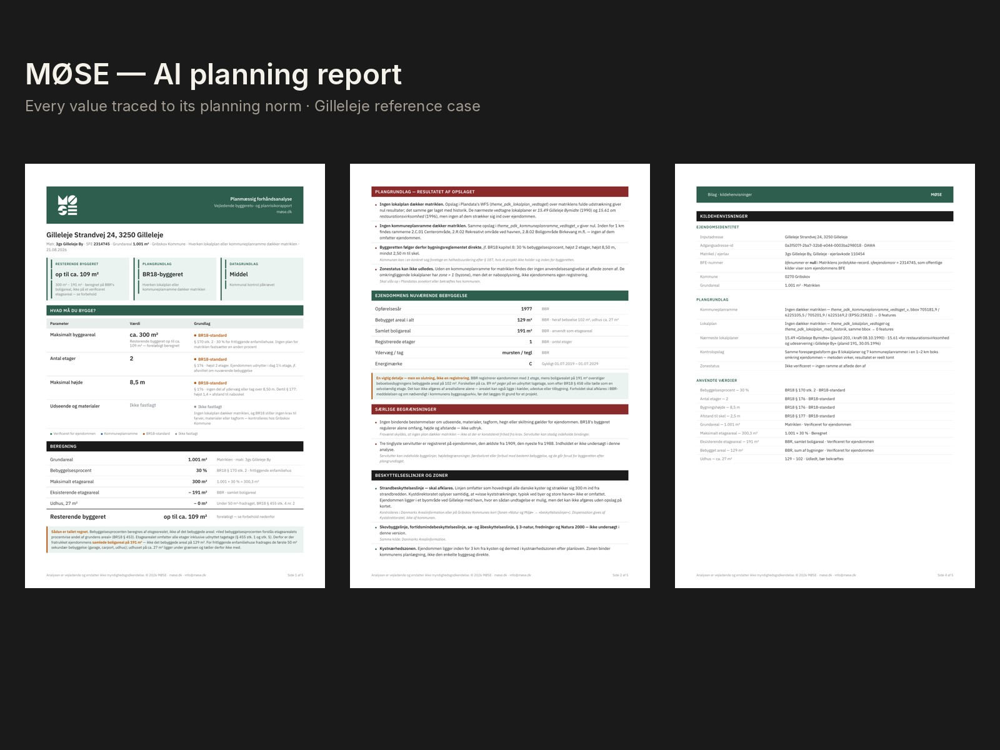
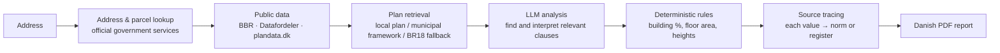
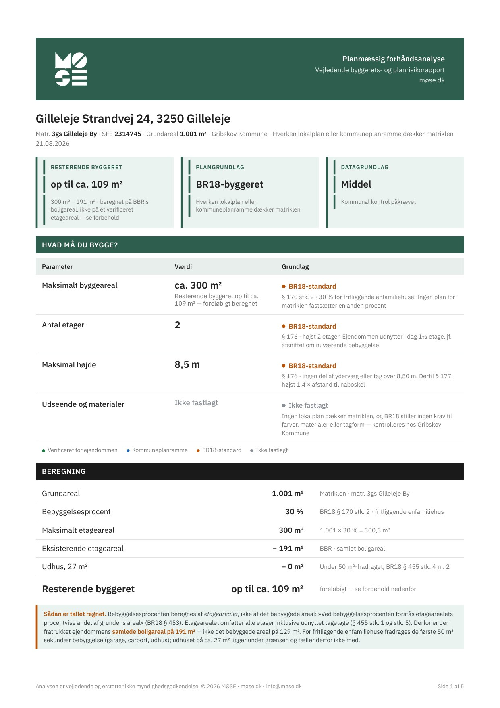
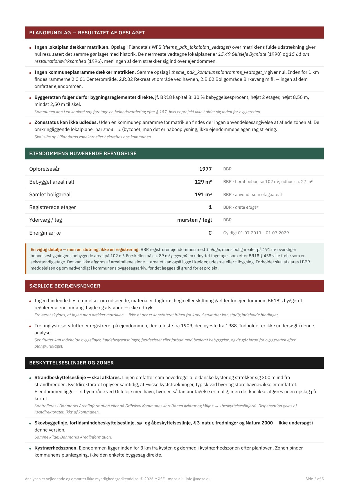
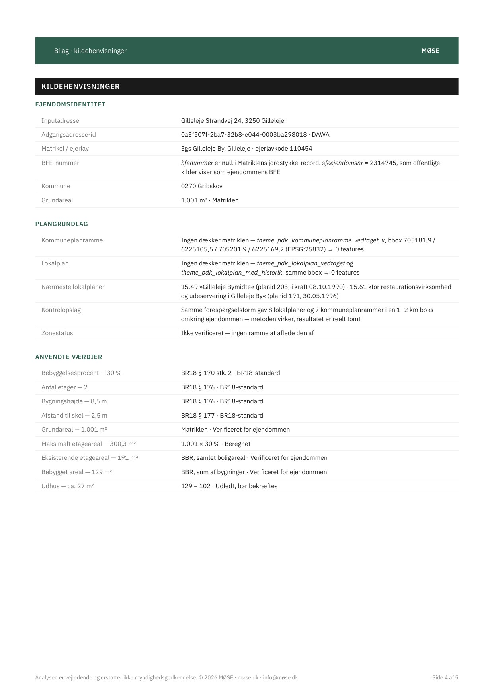

# MØSE — AI planning reports for Danish summer-house buyers

**What can I build on this plot?** Before buying a summer house in Denmark, a buyer has to dig through local plans (*lokalplaner*), municipal plan frameworks, the building regulations (BR18) and the building register (BBR) to find out how much they are allowed to build or extend. The documents are long, written in legal Danish and full of exceptions — so most buyers either skip the check or pay an architect.

MØSE turns an address into a short Danish PDF report: how much can be built, under which rule, and how sure we are. **Every number in the report is linked to the norm or register it comes from.**

> Status: pre-launch, built and run by me as founder and sole engineer (not yet a registered company).
> This repository is a public showcase — architecture, quality approach and a sample report. The product code is private; I'm happy to demo it.
> Website: [møse.dk](https://moese.dk)

## Why I built it

I worked as an architect for 13 years, reading planning documents and building regulations for clients. One wrong reading of a rule is expensive, and the same questions come up for every plot. MØSE is my attempt to make that first check fast, cheap and — above all — verifiable.

## Pipeline

1. **Address → parcel.** The address is resolved to the cadastral parcel and property number through official Danish government services. When the old DAWA address service was discontinued, I migrated all lookups to the official replacements rather than third-party APIs.
2. **Public data.** Plot area, existing buildings, floor area and construction year come from the registers (BBR, Datafordeler).
3. **Which plan applies?** Spatial queries against plandata.dk find whether a local plan or a municipal plan framework covers the parcel. If none does, the building rights follow BR18 directly — and the report says so explicitly.
4. **LLM where it helps.** The language model reads and interprets planning text: which clauses are relevant, what they mean for this plot.
5. **Rules where it matters.** Numbers — building percentage, maximum floor area, remaining building rights — are calculated deterministically, not generated by the model.
6. **Report.** HTML templates rendered to PDF, with a calculation table, caveats and a source appendix.

**Stack:** Python · FastAPI · LangChain / RAG · OpenAI API · Jinja2 · WeasyPrint · deployed on Render · website on WordPress/Elementor

## Quality approach

An AI report about building rights is only useful if a buyer can trust it. That is the core of the project, not an afterthought.

- **Every value has a source and a status.** Each line in the report is tagged as *verified for the property*, *municipal plan framework*, *BR18 standard* or *not determined* — the reader always sees where a number comes from and how strong it is.
- **Uncertainty is stated, not hidden.** If the data cannot answer a question (e.g. zone status, coastal protection line, easements), the report says what is unknown and where to check it instead of guessing. Each report carries an overall data-confidence level.
- **A hand-verified reference report.** I checked one complete report for a real address line by line against the regulations and registers. It is the benchmark: every change to the pipeline is compared against it.
- **A fixed regression set** of four real addresses with different planning situations, re-run after every change.
- **Blocks with hard quality gates.** When testing kept surfacing new data errors, I stopped the cycle of endless fixes and split the work into blocks; a block is closed only when the reference report matches.
- **Spec-driven development with AI coding agents.** I write precise technical specifications from production reports and logs; implementation is done with an AI coding agent and reviewed against the reference set.

## Sample report

Reference case: Gilleleje Strandvej 24, Gribskov Municipality (generated 21.08.2026). The report is in Danish; key points in English:

| Page | What it shows |
| --- | --- |
| [Page 1](images/report-page-1.jpg) | Summary: remaining building rights *up to approx. 109 m²*, planning basis *BR18 building rights* (no local plan or framework covers the parcel), data confidence *medium — municipal check required*. Table of what you may build, each value with its rule (BR18 §§ 170, 176, 177) and a step-by-step calculation: 1,001 m² × 30 % = 300 m² minus 191 m² existing floor area. |
| [Page 2](images/report-page-2.jpg) | Result of the plan lookup (no local plan, nearest plans listed), current buildings from BBR, an explicit note where the registry data look inconsistent, special restrictions, protection lines and zones — with what is *not* investigated. |
| [Page 4](images/report-page-4-sources.jpg) | Source appendix: property identity, the exact plan queries and their results, and every applied value with its source and verification status. |

  
  
  

*The analysis is advisory and does not replace approval by the authorities.*

## Contact

Lidiia Moisieieva — AI Systems Engineer, Copenhagen
[LinkedIn](https://www.linkedin.com/in/lidiia-moisieieva-3bbb5918a) · [GitHub](https://github.com/Leed131) · leed131@gmail.com
